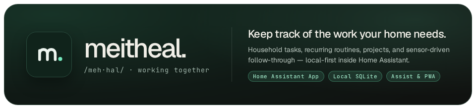
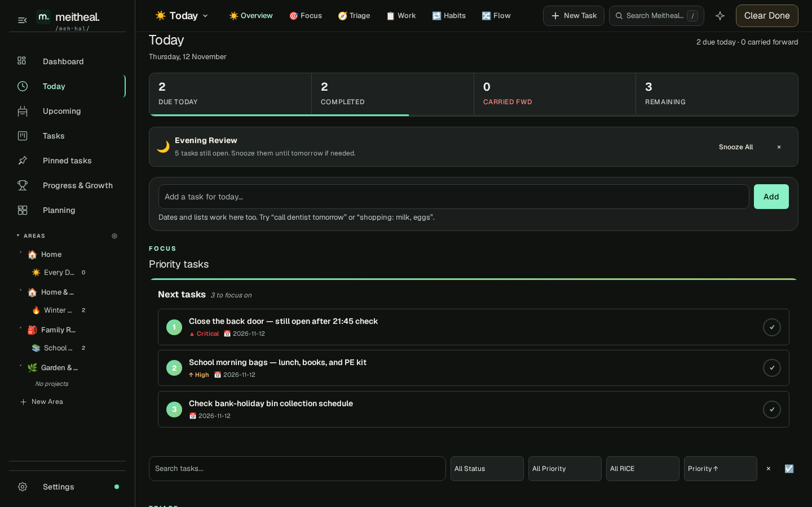
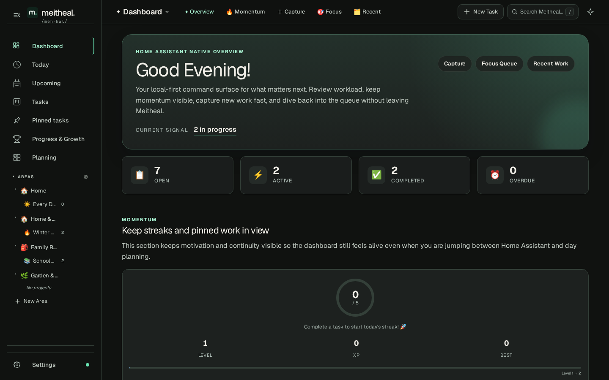
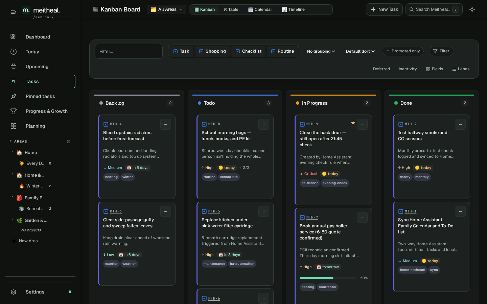
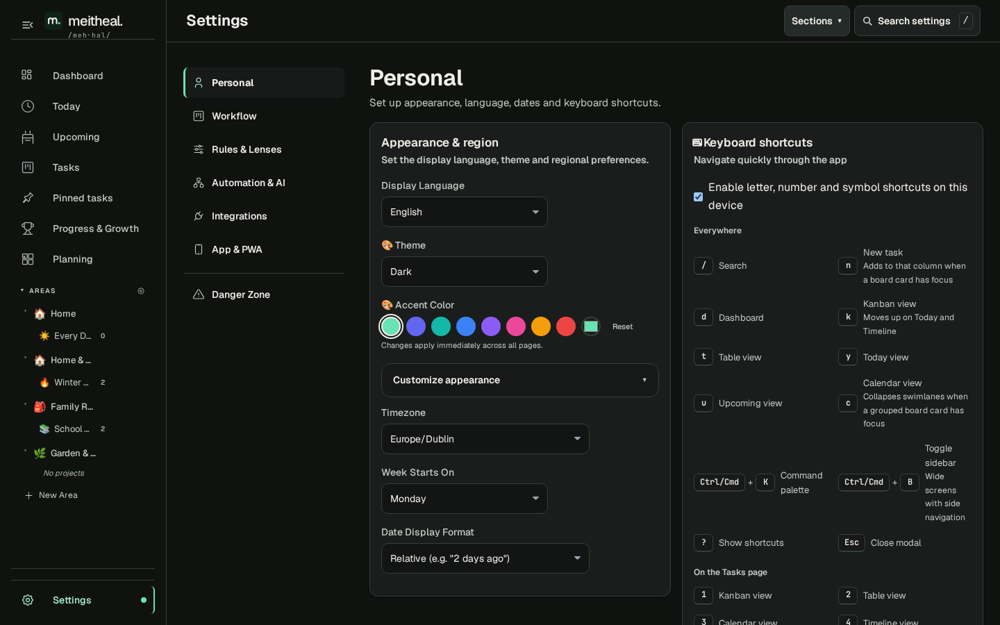

# Meitheal for Home Assistant

[meitheal.io](https://meitheal.io) · [Setup Guide](meitheal-hub/DOCS.md) · [Create Your First Task](docs/first-task.md) · [Canary Channel](meitheal-hub-canary/DOCS.md) · [Support & Issues](https://github.com/ryan-winkler/meitheal-ha-addon/issues)

**Meitheal** (`/meh·hal/`) is an Irish word for neighbors coming together to share the work that one household shouldn't carry alone.

Inside Home Assistant, **Meitheal keeps track of the work your home needs** — combining household tasks, recurring family routines, seasonal maintenance projects, and Home Assistant sensor/calendar automations in one calm, local-first app in your sidebar. Every task lives in SQLite on your own device and is protected by standard Home Assistant backups.

---

## Why Meitheal in Home Assistant?

Home Assistant already notices what happens in your house; Meitheal helps the people living there follow through without one person carrying the entire mental checklist:

| Home Signal or Rhythm | What Lands in Meitheal | How Your Household Uses It |
|---|---|---|
| `binary_sensor.back_door` open after `21:45` | **Close the back door — still open after 21:45 check** (`Critical`) | Surfaces immediately in **Today** and `todo.meitheal_tasks` until resolved |
| Weekday morning prep | **School morning bags — lunch, books, and PE kit** | Shared routine checklist anyone can tick off on phone or wall tablet |
| 6-month filter timer | **Replace kitchen under-sink water filter cartridge** | Scheduled ahead of time and synced to your Home Assistant calendar |
| Multi-step home upkeep | **Winter Boiler and Heating Prep** | Organized by **Area** and **Project** across **Kanban**, **Table**, and **Calendar** |

## Inside the App

| Today — Daily Focus & Routines | Household Dashboard & Focus Queue |
|---|---|
|  |  |
| **Kanban & Project Board** | **Home Assistant-Native Settings** |
|  |  |

## Quick Install in Home Assistant

Or add the repository manually in under a minute:

1. In Home Assistant, open **Settings → Apps → Install app** (called **Settings → Add-ons → Add-on Store** in earlier releases).
2. Open the top-right **⋮** menu and select **Repositories**.
3. Paste `https://github.com/ryan-winkler/meitheal-ha-addon` and select **Add**.
4. Choose **Meitheal** (or **Meitheal Canary** for preview builds) and select **Install**.
5. Select **Start**, enable **Show in sidebar**, and click **Open web UI**.

> **Install status:** Both **Meitheal** and **Meitheal Canary** pull verified multi-architecture (`amd64`, `aarch64`) container images. If you previously saw a `401` pull error on an older cached store manifest ([issue #1](https://github.com/ryan-winkler/meitheal-ha-addon/issues/1)), click **Check for updates / Reload** in the Home Assistant Store menu.

## Available Channels in This Repository

| App | Directory | Purpose |
|---|---|---|
| **Meitheal** | [`meitheal-hub/`](meitheal-hub/DOCS.md) | Primary household installation with full setup, calendar/to-do sync, Companion, and backup guidance |
| **Meitheal Canary** | [`meitheal-hub-canary/`](meitheal-hub-canary/DOCS.md) | Commit-stamped preview channel for testing upcoming features early in an isolated data directory |

## Why Two Repositories?

This repository (`meitheal-ha-addon`) is the **lightweight Home Assistant App Store catalog** for Meitheal:

| Repository | Purpose | Contents | Who Uses It |
|---|---|---|---|
| **[meitheal-ha-addon](https://github.com/ryan-winkler/meitheal-ha-addon)** (this repo) | Home Assistant App Store catalog | Lightweight Store manifests (`config.yaml`), brand icons, translations, screenshots, and install guides (~2 MB). | Home Assistant Supervisor & users installing Meitheal. |
| **[meitheal](https://github.com/ryan-winkler/meitheal)** | Application source & CI | Full monorepo source code, Astro SSR app, DDD packages, E2E tests, Dockerfiles, and automated CI pipelines (`dev` is default). | Contributors, reviewers, and automated release builds. |

Home Assistant Supervisor clones the full Git repository onto your device when you add a store URL and runs `git pull` on periodic refreshes. Keeping this catalog repository compact ensures low-memory hardware (such as Home Assistant Green or Raspberry Pi) stays fast and never downloads monorepo source or test suites just to check for app updates.

## Guides, Support & Licensing

- [Add-on Setup & Configuration (`DOCS.md`)](meitheal-hub/DOCS.md)
- [Create Your First Task](docs/first-task.md)
- [Canary Channel Guide](meitheal-hub-canary/DOCS.md)
- [Release Notes](https://github.com/ryan-winkler/meitheal/releases)
- [Support & Issue Tracker](SUPPORT.md) · [Contributing](CONTRIBUTING.md) · [Code of Conduct](CODE_OF_CONDUCT.md) · [Security Policy](SECURITY.md)

Read the [Meitheal application source](https://github.com/ryan-winkler/meitheal) to build from source or contribute. Source code is covered by its [source license](https://github.com/ryan-winkler/meitheal/blob/main/LICENSE); pre-built add-on container images are covered by the [distribution license](LICENSE) (free for personal and homelab use; see [COMMERCIAL.md](COMMERCIAL.md) for commercial terms).
